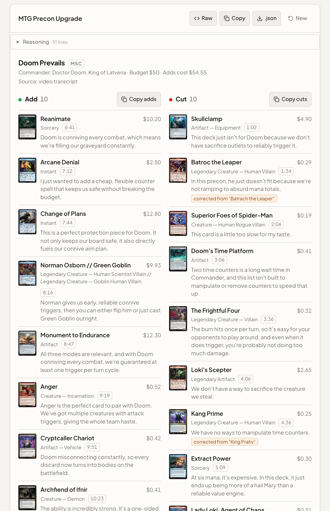
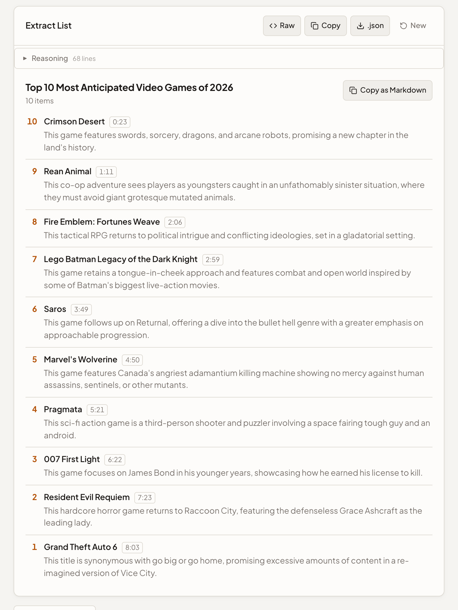

<p align="center">
  
</p>

<h1 align="center">Lumina</h1>

<p align="center">
  <strong>Transcribe, summarize and chat with audio, video, YouTube, web pages, PDFs and images.<br/>Your models, your server, your data.</strong>
</p>

<p align="center">
  <a href="#features">Features</a> •
  <a href="#screenshots">Screenshots</a> •
  <a href="#getting-started">Getting started</a> •
  <a href="docs/deployment.md">Deployment</a> •
  <a href="docs/api.md">API</a>
</p>

<p align="center">
  
  
  
  
  
  
</p>

---

## Why Lumina?

**Lumina is a self-hosted workbench for turning long content into something you can use.** Give it a two-hour video, a meeting recording, an article or a PDF. You get a summary, a ranked list with timestamps, meeting minutes, a recipe ready for Mealie, or a chat with the source. Transcription runs on your hardware, and the language model is your own Ollama instance.

It's built for people who already run a home server and want one tool that handles the whole path: download, transcribe, extract, think, format.

### Accurate on long content

- **The whole source, not the first chunk**: each model runs at its real context window (128K–256K for gemma4). Anything bigger is read in parts instead of being cut silently.
- **Timestamps everywhere**: transcripts keep `[m:ss]` markers, so lists, MTG cards and chat answers link straight to the moment in the video.
- **Video context included**: the title, channel, chapters and description go to the model with every transcript.
- **Native reasoning**: thinking models (gemma4, qwen3, gpt-oss) reason first. You can read that reasoning, but it never mixes into the answer.

### Self-hosted, private, yours

- **Local models**: Whisper-family transcription on your CPU or GPU, LLM work on your Ollama server.
- **No accounts, no telemetry**: outside requests are only the ones a feature needs. That means YouTube, the page you ask it to read, model downloads from Hugging Face, Scryfall / MTGJSON / Archidekt for the MTG mode, and the UI's fonts from Google Fonts.
- **Your prompts**: every mode's prompt is editable, and you can add your own modes.

---

## Screenshots

<p align="center">
  <picture>
    <source media="(prefers-color-scheme: dark)" srcset="docs/images/screenshots/mtg-upgrade-dark.png" />
    
  </picture>
</p>

<p align="center"><em>A precon upgrade video turned into the ten cards to add and ten to cut, each with price, reason and a timestamp link. Caption errors are corrected against the precon list.</em></p>

<p align="center">
  <picture>
    <source media="(prefers-color-scheme: dark)" srcset="docs/images/screenshots/extract-list-dark.png" />
    
  </picture>
</p>

<p align="center"><em>Extract List on a "top 10" video: every entry in countdown order, matched against the chapters.</em></p>

<p align="center"><a href="docs/images/screenshots/"><strong>See more screenshots →</strong></a></p>

---

## Features

### Summarize anything

- **Seven sources**: text, audio and video files, YouTube, web pages (rendered in headless Chromium), PDFs (as text, or as page images for vision models), and images.
- **Eleven modes**: Summary, TL;DR, Key Points, Action Items, Q&A, Mind Map, Meeting Minutes, Extract List, Recipe (Markdown or schema.org JSON-LD), MTG Precon Upgrade, and raw Transcript. See [Modes](docs/modes.md).
- **Structured results**: list, recipe and MTG modes use JSON schemas at a low temperature, so you get clean structured output with copy and export buttons, not prose.
- **Chat and translate**: ask follow-up questions about the full source, or translate any result into 15 languages.
- **Read aloud**: Kokoro text-to-speech with 28 English voices *(optional; download weights in Settings)*.

### YouTube, done properly

- **Best caption track**: creator captions beat auto-captions; language order is your language, then the original, then English. Audio transcription is the fallback.
- **One fetch per video**: transcripts are cached, so switching modes is instant.
- **Background queue**: YouTube and URL jobs keep running while you work elsewhere. You can watch partial output stream in, stop a job, or retry it from **Jobs**.

### MTG precon upgrades

- **Add and Cut lists**: from transcript, chapters and description, or exactly from a pasted decklist or Archidekt link.
- **Checked against reality**: names are verified with the original precon (MTGJSON) and Scryfall. Mismatches are flagged, not hidden.
- **Ready to paste**: `1 Card Name` lines for Moxfield or Archidekt, plus per-card prices, a total cost and swap pairs.

### Transcription and audio

- **Four engines**: faster-whisper (default), Whisper, NVIDIA Canary and Qwen Audio, on CPU or GPU. See [Engines](docs/engines.md).
- **Exports**: word-level timestamps, SRT/VTT export, clip extraction, and optional speaker diarization (pyannote).
- **Enhancement**: normalization, DeepFilterNet denoise, Demucs vocal isolation and LavaSR upsampling, applied one-off or as a step-by-step pipeline you preview before transcribing.
- **Podcasts**: subscribe to RSS feeds; new episodes are downloaded, transcribed and summarized in the queue.

### For your server

- **HTTP API for everything**: API-key or Basic Auth, OpenAPI docs at `/docs`. See [API](docs/api.md).
- **Searchable history**: every result is saved, with full-text search.
- **Low upkeep**: hourly cleanup of old audio, jobs and cache; healthcheck; settings live in SQLite and change without restarts.

---

## Getting started

### Requirements

- Docker with the Compose plugin
- An [Ollama](https://ollama.com) server with a model pulled, e.g. `ollama pull gemma4`
- [`just`](https://github.com/casey/just) *(recommended)*
- For GPU transcription: an NVIDIA GPU and the NVIDIA Container Toolkit

### Quick start

```bash
git clone https://github.com/brentonmallen1/whisper-gui.git lumina
cd lumina
cp .env.example .env          # set OLLAMA_URL and OLLAMA_MODEL
just build-playwright-base    # one-time: Chromium + ffmpeg base image
just up                       # build and start
```

Open **http://localhost:8880**. The first start downloads the transcription model into `./volumes/models`, and the page shows progress until it's ready. Set `ENABLE_GPU=true` in `.env` to use your GPU.

### Unraid

A template is included at [`unraid/lumina.xml`](unraid/lumina.xml). Push an image to your registry with `just release`, then add the template under *Docker → Add Container → Template*. Details are in [Deployment](docs/deployment.md#unraid).

### Develop it

The backend uses Python 3.12 managed by [uv](https://docs.astral.sh/uv/); the frontend uses Node 20+ and Vite.

```bash
just install      # Python deps, Playwright Chromium, npm packages
just dev          # backend with hot reload + Vite on http://localhost:5173
just test         # backend tests
just check-ui     # frontend type-check
```

Run `just` to list every recipe. More reading: [Configuration](docs/configuration.md) · [Deployment](docs/deployment.md) · [Modes](docs/modes.md) · [Engines](docs/engines.md) · [API](docs/api.md) · [Troubleshooting](docs/troubleshooting.md)

---

## Architecture

| Layer | Technology |
|---|---|
| Backend | Python 3.12, FastAPI, SQLite (settings, history, job queue, caches) |
| Frontend | React 18, TypeScript, Vite |
| AI | Ollama for LLM work; faster-whisper / Whisper / Canary / Qwen Audio for speech; Kokoro for TTS |
| Extraction | yt-dlp (with Deno), Playwright Chromium + readability, pdfplumber / PyMuPDF |
| Deployment | Docker (CUDA 12.6 runtime), Docker Compose, Unraid template |

## Roadmap

- **External browser for web pages**: point Lumina at a [browserless v2](https://github.com/browserless/browserless) container. Its WebSocket URL and token would be set as environment variables at setup, and Playwright connects over CDP instead of bundling Chromium. A self-contained image with a built-in browser stays available as an optional build, like `:canary` today.
- **Slimmer image** (currently ~7 GB):
  - Drop the `nvidia/cuda` runtime base. Torch's pip packages already ship CUDA and cuDNN, so the base duplicates ~2.6 GB.
  - Copy only Chromium's headless shell from the Playwright base, not full Chromium, Firefox and WebKit (~925 MB unused).
  - Build the frontend natively instead of under amd64 emulation.
  - Add a registry build cache so a pruned or new machine doesn't rebuild from scratch.
- Move the remaining in-memory tasks (audio enhancement, YouTube downloads, pipeline sessions) onto the persistent job queue
- Split the remaining API routes out of `main.py` into routers
- React 19 and React Router 7 upgrade
- More structured modes built on the same JSON-schema pipeline

---

## Contributing

Issues and pull requests are welcome. Run `just test` and `just check-ui` before opening a PR.

## License

No license has been chosen yet, so all rights are reserved. Bundled and downloaded models (Whisper, Canary, Qwen, Kokoro, Demucs, DeepFilterNet) and the data services used by the MTG mode have their own licenses and terms.
